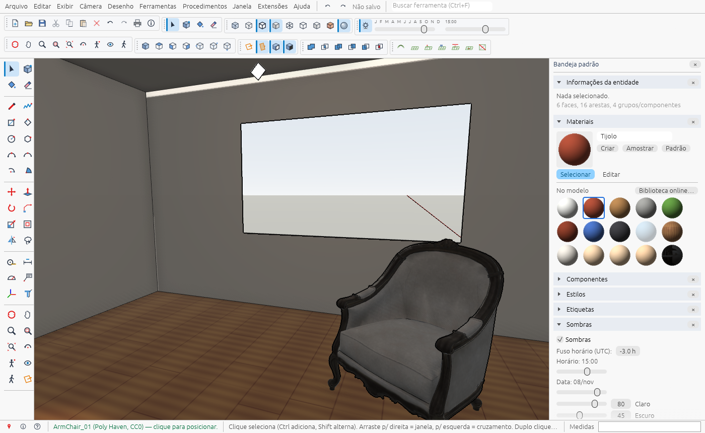
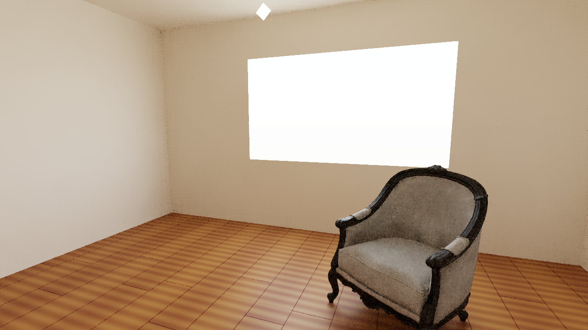

# HomeUp

**Modelador 3D para desktop, feito para projetos de arquitetura e design de interiores.**
Você desenha com linhas e faces, puxa volumes, mobilia o ambiente, ilumina e gera imagens
fotorrealistas em alta resolução, tudo num único programa nativo e rápido, escrito em Rust.



O fluxo de trabalho segue o do SketchUp: Linha, Retângulo, Push/Pull, inferência de pontos,
grupos e componentes, etiquetas, cenas, estilos, sombras pela posição do sol. Quem já usa o
SketchUp se sente em casa. O HomeUp também abre arquivos `.skp` direto e tem render
fotorrealista embutido na GPU, sem plugin.

| Render fotorrealista (GPU, 1280×720, 128 amostras, ~9 s) |
|---|
|  |

> HomeUp é um projeto independente, **sem relação com a Trimble ou com o SketchUp**. É uma
> reimplementação *clean-room*: o comportamento foi reproduzido a partir da documentação
> pública e da observação da interface, sem usar código, SDK ou assets do SketchUp.
> SketchUp é marca registrada da Trimble Inc.

---

## Sumário

- [O que ele faz](#o-que-ele-faz)
- [Instalar](#instalar)
- [Executar a partir do código](#executar-a-partir-do-código)
- [Primeiros passos](#primeiros-passos)
- [Do projeto à imagem final (interiores)](#do-projeto-à-imagem-final-interiores)
- [Formatos de arquivo](#formatos-de-arquivo)
- [Atalhos de teclado](#atalhos-de-teclado)
- [Para desenvolvedores](#para-desenvolvedores)
- [Limitações conhecidas](#limitações-conhecidas)
- [Créditos e licença](#créditos-e-licença)

---

## O que ele faz

**Modelagem**
- Linha, Retângulo (também girado), Círculo, Polígono, Arcos, Mão livre
- Push/Pull, Siga-me, Deslocar (offset), Mover/Copiar, Girar, Escala, Virar, Copiar ao longo
- Inferência de pontos e eixos (extremidade, meio, sobre aresta, paralelo, perpendicular) e
  digitação de medidas exatas na caixa **Medidas**
- Grupos, componentes (com instâncias), interseção de faces e operações booleanas
- Dividir, Soldar e Explodir curva, Borracha (apagar, ocultar, suavizar)
- Ferramentas Sandbox de terreno

**Organização e documentação**
- Etiquetas (com cor e tracejado), Outliner, cenas com transição
- Cotas, textos, texto 3D, transferidor, fita métrica e guias, eixos
- Planos de seção com preenchimento e hachura, Gerar relatório (CSV), Classificador e exportação **IFC4**

**Visual**
- Estilos de face e de aresta (inclusive croqui à mão), raio-X, céu e chão, neblina, marcas d'água
- Materiais PBR (cor, imagem, rugosidade, metal, normal, oclusão), Posicionar textura com pinos
- Sombras reais pela posição do sol, conforme data, hora e localização
- Ambientes HDRI
- **Combinar foto:** modele por cima de uma fotografia calibrando a câmera pelos pontos de fuga

**Interiores e render**
- Importação de plantas em **DXF** e **PDF vetorial**, com escala correta
- Ajuste de escala pela fita métrica: meça uma parede, digite a medida real, e o modelo se ajusta
- Luminárias (lâmpada, spot, painel de LED) com cor, temperatura e fluxo em lúmens
- **Biblioteca online** gratuita (CC0): móveis do Poly Haven, materiais do ambientCG e do Poly Haven,
  HDRIs, tudo baixado direto no programa
- Exportação de imagem até **8K**, de dois jeitos:
  - **Rápida:** a mesma imagem da tela, instantânea
  - **Fotorrealista:** *path tracing* na GPU com luz rebatida, sombras suaves, reflexos, vidro,
    exposição automática e remoção de ruído

A lista completa, com o status de cada item, está em [docs/especificacao.md](docs/especificacao.md).

---

## Instalar

### Windows (instalador)

1. Gere ou baixe o `HomeUp-<versão>-setup.exe` (como gerar: [Gerar o instalador](#gerar-o-instalador)).
2. Execute. Por padrão ele instala só para o seu usuário, sem pedir administrador.
3. Abra pelo Menu Iniciar. Arquivos `.homeup` passam a abrir com duplo clique.

> O instalador ainda não tem assinatura digital. O Windows pode mostrar
> **"O Windows protegeu o computador"**. Para continuar, clique em **Mais informações** e
> depois em **Executar assim mesmo**.

### Requisitos

- Windows 10 ou 11, 64 bits
- Placa de vídeo com suporte a DirectX 12 ou Vulkan. Qualquer GPU integrada ou dedicada dos
  últimos ~8 anos serve, e o render fotorrealista fica bem mais rápido numa GPU dedicada.
- Internet só para a Biblioteca online. O resto funciona offline.

---

## Executar a partir do código

Pré-requisitos:
- [Rust](https://rustup.rs/) 1.85 ou mais novo (o projeto usa a edição 2024)
- No Windows, as *Build Tools* do Visual Studio, com o workload "Desenvolvimento para desktop com C++".
  O `rustup` oferece instalar.

```bash
git clone https://github.com/PClima/HomeUp.git
cd HomeUp
cargo run --release
```

O executável fica em `target/release/homeup.exe`. Para abrir um arquivo direto:

```bash
target/release/homeup.exe caminho/do/modelo.homeup
```

> Se você tiver a variável de ambiente `CARGO_TARGET_DIR` definida, ela muda a pasta de build.
> Para manter tudo dentro do projeto, passe `--target-dir target`.

O desenvolvimento e os testes foram feitos no Windows. As bibliotecas usadas (wgpu, egui)
funcionam em Linux e macOS, mas esses sistemas ainda não foram testados.

---

## Primeiros passos

1. Ao abrir, escolha um **modelo** (template) na página inicial.
2. **Retângulo (R):** clique um canto e o outro no chão. Para medidas exatas, digite `4;5`
   e Enter, ou seja, 4 m × 5 m.
3. **Push/Pull (P):** clique na face e suba. Digite `2,7` e Enter para 2,70 m.
4. **Orbitar (O)**, **Pan (H)** e **Zoom (Z)**. A roda do mouse dá zoom e o botão do meio orbita.
   `Shift+Z` enquadra tudo.
5. **Pintar (B):** escolha um material no painel **Materiais** e clique nas faces.
6. **Salvar (Ctrl+S)** grava um arquivo `.homeup`.

Os painéis ficam na **Bandeja padrão**, à direita: Informações da entidade, Materiais,
Componentes, Estilos, Etiquetas, Sombras, Cenas, Ambientes, Outliner e Biblioteca. Abra e feche
cada um em **Janela > Painéis da bandeja**. Em **Janela > Interface** dá para trocar para uma
interface simplificada, no estilo do SketchUp para web.

---

## Do projeto à imagem final (interiores)

1. **Planta:** **Arquivo > Importar planta** aceita DXF ou PDF vetorial. Para planta em foto ou
   escaneada, use **Importar imagem** e desenhe por cima. Um `.skp` abre por **Arquivo > Abrir**.
2. **Escala:** meça uma parede conhecida com a **Fita métrica (T)** e digite a medida real. O
   HomeUp oferece redimensionar o modelo inteiro, ou só o grupo que estiver sendo editado.
3. **Paredes:** desenhe as paredes sobre a planta com Linha ou Retângulo e suba com Push/Pull até
   o pé-direito. Abra portas e janelas desenhando o vão na parede e empurrando até atravessar.
4. **Acabamentos:** escolha materiais em **Materiais > Biblioteca online…**, por exemplo madeira,
   piso ou pintura, e ajuste o tamanho da textura em **Editar**.
5. **Móveis:** use **Componentes > Biblioteca online…** ou importe modelos do 3D Warehouse
   (veja [Formatos de arquivo](#formatos-de-arquivo)).
6. **Luz:** **Desenho > Luz** cria lâmpada, spot ou painel. Cada luz é um componente comum: mova,
   copie e ajuste cor, temperatura (K) e lúmens em Informações da entidade. Ligue o sol no painel
   **Sombras** e escolha um céu ou HDRI em **Ambientes**.
7. **Enquadramento:** posicione a câmera e salve como **cena**.
8. **Imagem:** em **Arquivo > Exportar > Imagem (alta resolução, render)**, escolha o tamanho
   (até 8K) e o modo **Fotorrealista**. A janela de render mostra o progresso, deixa ajustar a
   exposição e ligar ou desligar a remoção de ruído, e salva em PNG ou JPG.

Para ter uma ideia do tempo: uma sala em 1280×720 com 128 amostras leva cerca de 9 s numa GPU
dedicada, e um 4K com 256 amostras leva cerca de 2,5 min. Sem GPU compatível, o render roda no
processador, bem mais devagar.

---

## Formatos de arquivo

| Formato | Abrir | Importar | Exportar |
|---|:-:|:-:|:-:|
| `.homeup` (formato próprio) | ✅ | | ✅ |
| `.skp` SketchUp 2021 em diante | ✅ | ✅ (como componente) | |
| OBJ, glTF/GLB, STL, Collada (DAE) | | ✅ | OBJ, STL |
| DXF, PDF vetorial (plantas) | | ✅ | |
| PNG, JPG, WebP (imagens e fotos) | | ✅ | PNG, JPG (até 8K) |
| HDR, EXR (ambientes) | | ✅ | |
| IFC4 | | | ✅ |
| CSV (relatório) | | | ✅ |

**Modelos do 3D Warehouse:** baixe o modelo pelo navegador, com a sua conta, e use
**Arquivo > Importar…**, ou arraste o arquivo para a janela. O leitor de `.skp`
([src/skpfile.rs](src/skpfile.rs)) foi escrito do zero a partir da análise de arquivos de
exemplo. Ele lê geometria, grupos, componentes, materiais com textura, etiquetas com
tracejado, câmera e localização.

**DWG:** é um formato fechado. Salve como DXF no programa de CAD antes de importar.

---

## Atalhos de teclado

| Tecla | Ferramenta | Tecla | Ferramenta |
|---|---|---|---|
| `Espaço` | Selecionar | `M` | Mover / Copiar (com Ctrl) |
| `Shift+Espaço` | Laço | `Q` | Girar |
| `L` | Linha | `S` | Escala |
| `R` | Retângulo | `F` | Deslocar (offset) |
| `C` | Círculo | `T` | Fita métrica |
| `A` | Arco | `B` | Pintar |
| `P` | Push/Pull | `E` | Borracha |
| `O` | Orbitar | `H` | Pan |
| `Z` | Zoom | `Shift+Z` | Enquadrar tudo |
| `G` | Criar componente | `Ctrl+G` | Criar grupo |
| `Ctrl+Z` / `Ctrl+Y` | Desfazer / Refazer | `Ctrl+S` / `Ctrl+Shift+S` | Salvar / Salvar como |
| `Ctrl+O` / `Ctrl+N` | Abrir / Novo | `Ctrl+A` | Selecionar tudo |
| `Ctrl+F` | Buscar ferramenta | `Esc` | Cancelar |

---

## Para desenvolvedores

### Testes

```bash
cargo test --release
```

### Capturas automáticas (testes visuais sem mouse e teclado)

O app tem um modo de captura que monta uma cena, renderiza e salva um PNG sem precisar de
interação:

```bash
HOMEUP_SNAPSHOT=target/snapshots/x.png HOMEUP_SNAPSHOT_SETUP=demo,shadows=900,panel=shadows target/release/homeup.exe
```

Algumas opções de `HOMEUP_SNAPSHOT_SETUP`:

| Opção | O que faz |
|---|---|
| `demo` | Monta um modelo de demonstração |
| `room` | Monta uma sala de teste com piso de madeira, luzes e poltrona |
| `ptrace=1280x720x128:saida.png` | Renderiza em fotorrealista e salva |
| `rexport=3840x2160:saida.png` | Exporta a imagem rápida em alta resolução |
| `openskp=arquivo.skp` | Abre um .skp |
| `panel=materials`, `panel=outliner`, `style=4`, `web` | Painéis, estilos e interface simplificada |
| `libmat=Wood049`, `libhdri=<id>` | Material ou HDRI da biblioteca |

Variáveis úteis: `HOMEUP_PT_CPU=1` força o render no processador. `HOMEUP_PT_TILE_ROWS=N` força
a divisão do render em faixas, para testar.

### Gerar o instalador

```powershell
winget install JRSoftware.InnoSetup   # uma vez
scripts\build-installer.ps1
```

O script compila em release e gera `dist\HomeUp-<versão>-setup.exe`, de cerca de 8 MB. O
instalador cria os atalhos, associa `.homeup` (e, se você marcar, `.skp`) e registra o
desinstalador. O `.exe` sai com o ícone de [assets/homeup.ico](assets/homeup.ico) e com o
runtime C estático, sem depender do VC++ Redistributable.

### Tecnologia

- **Rust**: sem dependências nativas além do sistema
- **wgpu**: renderização (DirectX 12, Vulkan, Metal) e o render fotorrealista em compute shader WGSL
- **egui / eframe**: interface
- **glam**: matemática (geometria em `f64`)

### Estrutura do código

| Arquivo | Papel |
|---|---|
| `geom.rs` | Núcleo geométrico: faces com furos, recálculo por plano, Push/Pull, interseção, transformações, solda |
| `doc.rs` / `settings.rs` | Documento, grupos e componentes, materiais, guias, cenas, cotas, seções, etiquetas, estilos, sombras, unidades |
| `modops.rs` | Siga-me, interseção de faces, booleanas CSG |
| `tools*.rs`, `annot.rs`, `camtools.rs` | Ferramentas |
| `pick.rs` | Cache de seleção e motor de inferência |
| `scene.rs` / `render.rs` | Cena e renderizador wgpu: PBR, MSAA, sombras, SSAO, perfis, seção, neblina, céu/HDRI, luzes |
| `app.rs`, `chrome.rs`, `panels.rs`, `filemenu.rs`, `icons.rs`, `icons2.rs` | Interface: menus, barras, painéis, ícones vetoriais |
| `desktop.rs` | Layout desktop: barras, Large Tool Set, abas de cenas, Bandeja padrão, barra de status |
| `trayui.rs` | Painéis Materiais, Componentes, Cenas, Ambientes e Outliner |
| `thumbs.rs` | Miniaturas e prévia de material |
| `clipboard.rs` | Recortar, copiar, colar, colar no lugar |
| `library.rs` / `tex.rs` | Biblioteca online CC0 e texturas |
| `editops.rs` | Dividir, Soldar, Explodir curva, Área, modos do Pintar |
| `templates.rs` / `report.rs` | Modelos (templates) e Gerar relatório (CSV) |
| `imageimport.rs` / `matchphoto.rs` | Imagens 2D e Combinar foto |
| `watermark.rs` / `hatch.rs` / `texpos.rs` | Marcas d'água, hachuras e tracejados, Posicionar textura |
| `procedural.rs` / `sandbox.rs` | Copiar ao longo e ferramentas de terreno |
| `bim.rs` | Classificador IFC, exportação IFC4 e Créditos |
| `export.rs` | Exportação de imagem em alta resolução |
| `pathtrace.rs` | Render fotorrealista: cena, BVH (SAH), materiais, exposição, remoção de ruído, versão CPU |
| `gpupt.rs` | O mesmo traçador em WGSL, rodando na GPU |
| `lights.rs` | Luminárias (pontual, spot, painel) |
| `cadimport.rs` | Importação de plantas DXF e PDF vetorial |
| `import.rs` / `skp.rs` | Importadores OBJ, glTF, STL, DAE |
| `skpfile.rs` | Leitor nativo de `.skp` (SketchUp 2021+) |
| `snapshot.rs` | Modo de captura para testes visuais |

Dados do usuário (preferências, cache da biblioteca, salvamento automático e `crash.log`) ficam em
`%APPDATA%\HomeUp`.

---

## Limitações conhecidas

- **Portas e janelas** ainda não são objetos paramétricos. O vão é recortado à mão.
- `.skp` **anteriores ao SketchUp 2021** não abrem. Do `.skp` também ainda não vêm cenas, cortes,
  cotas e o posicionamento de textura por face.
- **DWG** não abre. Salve como DXF.
- Não há componentes dinâmicos, materiais gerados por IA nem LayOut.
- O render fotorrealista não simula cáusticas nem subsuperfície.
- O instalador não é assinado digitalmente.

---

## Créditos e licença

- Modelos, materiais e HDRIs da Biblioteca online vêm do [Poly Haven](https://polyhaven.com) e do
  [ambientCG](https://ambientcg.com), sob licença **CC0**. O HomeUp mostra o crédito na interface.
- Bibliotecas Rust de terceiros, cada uma com a própria licença: veja [Cargo.toml](Cargo.toml).

**Licença:** ainda não definida. Até lá, **todos os direitos reservados** © 2026 Pedro Cordeiro Lima.
O código está público para consulta, e o uso, a cópia ou a redistribuição dependem de autorização.
